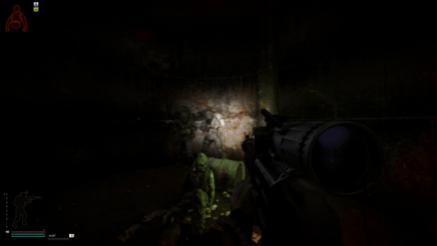
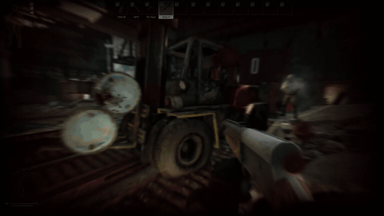
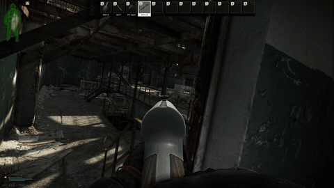
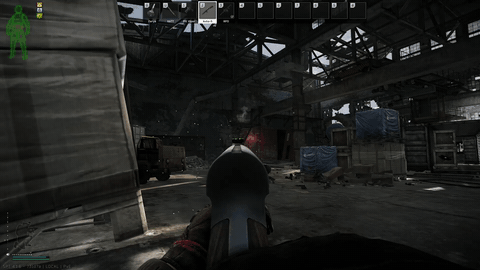
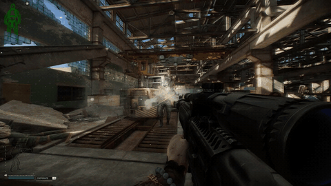
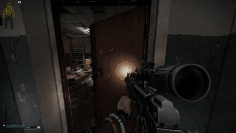

# Euphoria Style Physics

SPT 4.1.6 client plugin (BepInEx) that makes Tarkov bodies react the way Euphoria-driven characters do: shot bodies
stumble, clutch the wound and give at the knees instead of dropping like a sack, survivors flinch and keep fighting,
blasts throw bodies, and corpses near you stay physical.

**Test release.** It works out of the box; the parts that change fights are experimental and off by default.

## Videos

[](docs/media/video-1.mp4)
[](docs/media/video-2.mp4)
[](docs/media/video-3.mp4)
[](docs/media/video-4.mp4)
[](docs/media/video-5.mp4)
[](docs/media/video-6.mp4)

## Install

Download the zip from [Releases](../../releases/latest) and extract it into your SPT folder (the one with `BepInEx`).
You get `BepInEx/plugins/EuphoriaStylePhysics/` with `EuphoriaStylePhysics.dll`, `EuphoriaStylePhysics.Fika.dll`
(only loaded when Fika is installed) and `README.txt`.

Fika: install the same version on every machine, the headless host included.

## What it does

On by default (visual, how bodies look):

- **Dying with muscles:** a body killed on its feet stumbles the way the round pushed it, a hand goes to the wound, the
  knees give, then it drops (sometimes with a twitch). Headshots: the legs go at once, or head first, then the body.
- Running deaths tumble forward with their run; crouched deaths slump; falling bodies put their arms out. Bots killed
  lying prone or in mid-air die on our physics too.
- A dying bot lets go of its weapon.
- Knife deaths: both hands go to the wound and the body folds onto its knees.
- A dying body near a wall or low cover staggers to it, puts a hand on it and slides down it.
- Some bodies lie hurt for a few seconds: curled up, a hand on the wound or reaching toward the shooter.
- **Blast throw:** grenades throw bodies up and away (arms guard the head, legs tuck, hard landing).
- **Hit flinch:** bots and other players flinch when hit (spine, head snap, knee buckle, arm jerk), on top of EFT's own
  hit reaction. Visual only: AI aim and hitboxes never see it, and never your own body.
- **Explosion flinch:** survivors recoil away from a blast.
- **Corpses stay physical near you:** EFT freezes a corpse once it lies still; within 12 m of you it stays a ragdoll, so
  rounds, blasts and other bodies still move it. Walk away and EFT freezes it again (local only, not synced). "Never freeze corpses" (off) keeps them all physical.
- **Walking pushes corpses:** walk or run into a physical body and it gets pushed the way you go.
- **Smooth body collisions:** bodies roll down stairs instead of sinking into the steps and popping out, and a body
  lying on stairs can still be searched from above.

Off by default (experimental, changes gameplay; turn on in F12 if you want them):

- **Knockdowns:** a bot hit hard goes down on its own ragdoll, writhes, rolls over and gets back up through prone; a bot
  with a bad leg may sit up and fire back. Explosions close by can throw survivors down.

Gameplay parts only run where the bots' AI runs: single player, a raid hosted on your PC, or the Fika headless host.
The host sends knockdowns to every Fika client.

## Settings

F12 (BepInEx Configuration Manager) > **Euphoria Style Physics**. Every main feature has its own switch in
"1. General", and again at the top of its own section: "2. Dying", "3. Hit flinch", "4. Knockdowns" and "5. Corpses". The **Euphoric** style preset (default)
writes its values once (no kill is left to EFT's own ragdoll); change anything afterwards. **Custom** sets nothing for you.

Toggle key: **Ctrl+Shift+E** turns the whole mod on or off in game.

Log: `BepInEx/LogOutput.log`, lines starting with `[EuphoriaStylePhysics]`. Please include it with bug reports.

## Other mods

- **RealTargets:** works together. Its bullet push (Impacts) moves dead bodies and dying bodies once they are going down
  (not while still on their feet); our own round push is then left out (so nothing is pushed twice). Its Blast injuries throws grenade kills within 6 m; our blast throw then leaves those bodies to it. If
  bodies fly too far from bullets, lower RealTargets' Impacts > Push strength.
- **Inventory Walker:** works together; its loot range on a body is measured from where the body lies.
- **Smoothie:** works together. Its 60 Hz physics cap pauses while this mod moves a body (so deaths stay smooth above
  60 FPS), and in Fika its "Corpses stop moving after" setting leaves bodies alone while they are still dying.
- **Body-dragging mods:** [KMA - Keep Me Alive](https://sp-mod.com/mod/3269/kma-keep-me-alive) takes a corpse over through
  the CorpseLeaseV1 API ([docs/CorpseLease.md](docs/CorpseLease.md)); other mods can use it the same way.
- **HollywoodFX:** keep its "08. Ragdoll Effects" off. On, it pushes every shot body hard and changes every body
  part's weight, drag and bounce, which fights this mod. Its gore, blood and explosion effects are fine.

## Building

Needs the .NET SDK and an SPT 4.1.6 install (with Fika for the Fika DLL).

```
dotnet build plugin/ActiveRagdoll.csproj -c Release -o plugin/out -p:SPTPath="C:\path\to\SPT"
dotnet build fika/EuphoriaStylePhysics.Fika.csproj -c Release -o fika/out -p:SPTPath="C:\path\to\SPT"
```

Build the plugin first; the Fika project references `plugin/out/EuphoriaStylePhysics.dll`. The main DLL never names
a Fika type, so it loads without Fika.

## Credits

Inspired by **Project Real Limbs** (Project Zomboid) by deewindler, https://www.youtube.com/@DwindleDwindle
(CC BY-NC 4.0). Changed: this is a new Unity/C# implementation for Tarkov; no Real Limbs code is used. Some of its
ideas and default values (drop dead chance 0.25, headshot legs-go chance 0.25, twitch strength 0.75, no-twitch chance
0.7) are adapted. Non-commercial.

"Euphoria" refers to the style of motion only. This project is not affiliated with NaturalMotion, Rockstar Games or
Battlestate Games.
